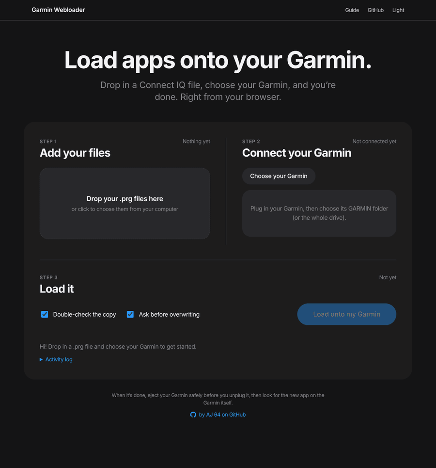

<p align="center">
  <a href="https://aj-64x.github.io/Garmin-Webloader/">
    
  </a>
</p>

<h3 align="center">Drop a file. Choose your Garmin. Load.</h3>

<p align="center">
  No installs. No drivers. Your files never leave your computer.
</p>

<p align="center">
  <a href="https://aj-64x.github.io/Garmin-Webloader/"><b>Open Webloader</b></a>
  &nbsp;·&nbsp;
  <a href="https://aj-64x.github.io/Garmin-Webloader/guide/">Read the guide</a>
</p>

<p align="center">
  
</p>

<br>

## How it works

**1. Add.** Drop in your `.prg` file. That’s any Connect IQ app, watch face, widget or data field.

**2. Connect.** Plug in your Garmin and choose its `GARMIN` folder.

**3. Load.** Press the button, then eject safely and unplug.

<br>

## Works on

Chrome, Edge, Opera, Vivaldi and Arc, on Windows, Mac and Linux.<br>
Chrome 132 or newer on Android, with a USB cable.<br>
Brave, after you turn on `brave://flags/#file-system-access-api`.

Not Firefox, Safari or iPhone. Use the command line instead.

<br>

## Command line

Same thing, no browser. Needs only Python or Node.

```bash
python3 cli/webloader.py app.prg          # load
python3 cli/webloader.py list             # see what's on your Garmin
python3 cli/webloader.py remove app.prg   # take an app off

node cli/webloader.js app.prg             # or with Node
```

<br>

## Make your own

No `.prg` yet? [`monkeyc/SimpleFace`](monkeyc/SimpleFace) is a small watch face in Monkey C, with a [step-by-step guide](monkeyc/SimpleFace/README.md) to build it.

<br>

## Need a hand?

<details>
<summary>My browser isn’t supported</summary>
<br>
Use Chrome or Edge on a computer, or Chrome 132+ on Android. If it got it wrong, press <b>Try anyway</b>.
</details>

<details>
<summary>It won’t let me choose the folder</summary>
<br>
Choose the <code>GARMIN</code> folder inside the drive instead of the drive itself. On Android, open <code>GARMIN</code>, then tap “Use this folder” and “Allow”.
</details>

<details>
<summary>I can’t find my Garmin, or my app isn’t on it</summary>
<br>
Try another USB cable and port. Some newer watches show up as a media device instead of a drive, so copy the file into <code>GARMIN/Apps</code> by hand. After loading, eject safely, restart your Garmin, and make sure the file was built for your exact model.
</details>

There’s also a [plain-English guide](https://aj-64x.github.io/Garmin-Webloader/guide/) to putting apps on a Garmin.

Still stuck? [Tell us what happened](../../issues/new/choose).

<br>

<p align="center">
  <sub>By <a href="https://github.com/aj-64x">AJ 64</a>, built with help from Claude. MIT licensed.</sub>
</p>
