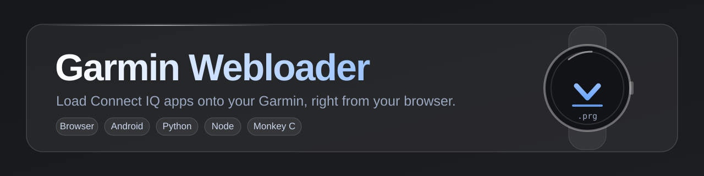

<p align="center">
  
</p>

# Garmin Webloader

Put apps on your Garmin without installing anything. Drop in a `.prg` file, pick your Garmin, press one button.

<p align="center">
  <a href="https://aj-64x.github.io/Garmin-Webloader/"><b>Open Webloader →</b></a>
</p>

## Quick start

1. **Get a `.prg` file.** That’s a Connect IQ app, watch face, widget or data field. No file yet? [Build one](monkeyc/SimpleFace/README.md) or download one you already have.
2. **Plug your Garmin into your computer** with its USB cable.
3. **Open Webloader.** Drop the file in, choose your Garmin’s `GARMIN` folder, and press **Load onto my Garmin**.
4. Press **Eject safely**, unplug, and look for the new app on your Garmin.

That’s it. Your files never leave your computer. Everything happens in your browser.

## Will it work for me?

| Where you’re using it | Works? |
| --- | --- |
| Chrome, Edge, Opera, Vivaldi or Arc on Windows, Mac or Linux | Yes |
| Chrome on an Android phone (version 132 or newer) | Yes, with a USB cable (some phones need an OTG adapter) |
| Brave | Yes, after turning on `brave://flags/#file-system-access-api` |
| Firefox, Safari, Samsung Internet | No, but the [command line tools](#no-browser-use-the-command-line) below do the same job |
| iPhone or iPad | No |

Your Garmin needs to show up on your computer as a drive with a `GARMIN` folder. Some newer watches connect as a “media device” instead. If yours does, just copy the `.prg` file into `GARMIN/Apps` yourself.

## No browser? Use the command line

Same job, no browser. Nothing to install beyond Python or Node.

```bash
# Python 3.8 or newer
python3 cli/webloader.py app.prg          # load a file onto your Garmin
python3 cli/webloader.py list             # see what's already on it
python3 cli/webloader.py remove app.prg   # take an app off it

# Node 16 or newer
node cli/webloader.js app.prg
```

They find your Garmin on their own, and ask which one if you have several plugged in. Handy extras: `-d PATH` points at the `GARMIN` folder yourself, `-y` skips the questions, `--no-verify` skips the double-check.

## Make your own watch face

[`monkeyc/SimpleFace`](monkeyc/SimpleFace) is a small watch face written in Monkey C, Garmin’s own language. It shows the time, date, heart rate, steps, battery and one extra field. Its [README](monkeyc/SimpleFace/README.md) walks you through building it, step by step.

## Troubleshooting

<details>
<summary>It says my browser isn’t supported</summary>

Webloader needs your browser’s folder-access feature. Use Chrome or Edge on a computer, or Chrome 132+ on Android. If you think the check got it wrong, there’s a **Try anyway** button on that screen.
</details>

<details>
<summary>The browser won’t let me choose the folder</summary>

Some browsers refuse to open the very top of a drive. Choose the **GARMIN** folder inside it instead. On Android, open the GARMIN folder, then tap “Use this folder” and “Allow”.
</details>

<details>
<summary>I can’t see my Garmin at all</summary>

Try a different USB cable (some only charge) and a different USB port. Wait a few seconds after plugging in. If your Garmin shows up as a media device rather than a drive, copy the file into `GARMIN/Apps` by hand.
</details>

<details>
<summary>It loaded, but the app isn’t on my Garmin</summary>

Press **Eject safely** and wait for your computer to say it’s safe before unplugging, then restart the Garmin. Make sure the `.prg` was built for your exact model. A file built for a different watch won’t show up.
</details>

<details>
<summary>It says there’s no GARMIN folder</summary>

You’ve probably picked the wrong drive. Look for the one named `GARMIN` that contains `Apps`, `Activities` or `GarminDevice.xml`.
</details>

Still stuck? [Tell us what happened](../../issues/new/choose). It helps to know your Garmin model and browser.

## Helping out

Found a bug or have an idea? [Open an issue](../../issues/new/choose). Pull requests are welcome too. The website is a single file, `index.html`, so it’s easy to read and change.

## Credits

By [AJ 64](https://github.com/aj-64x), built with help from Claude (Anthropic).
